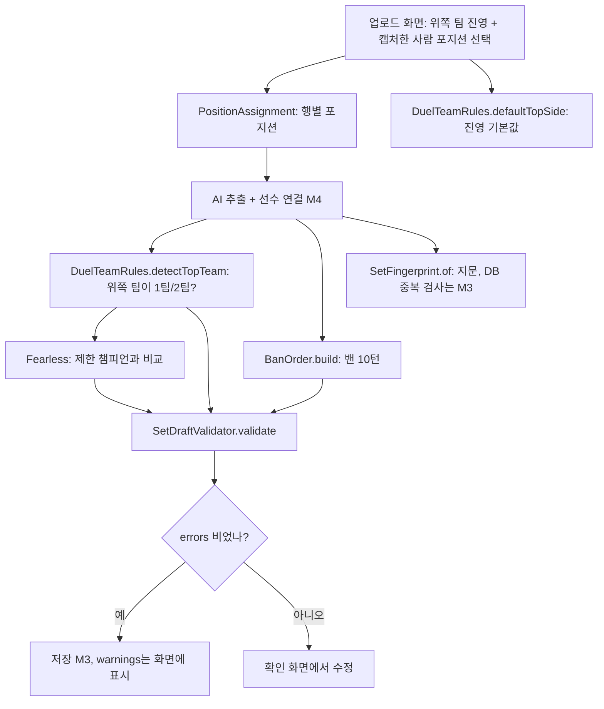

# 06. 세트 도메인 규칙 (M2)

> 코드: `backend/src/main/java/com/lolinhouse/domain/set/` · 테스트: `backend/src/test/java/com/lolinhouse/domain/set/`
> 결정 기록: [ADR 004 세트 지문](../adr/004-set-fingerprint.md) · 기준 문서: `docs/유저플로우.md` §1, §5.1~5.5, §6
> 선수 매칭·통계는 [노트 07](07-domain-player-stats.md).

## 1. 무엇을 만들었나

결과창 스크린샷 한 장(=세트 하나)을 저장하기 전에 필요한 **계산 규칙 6개**를 순수 Java로 만들고 테스트로 고정했다. Spring도 DB도 없다.

| # | 규칙 | 한 줄 요약 |
|---|---|---|
| 1 | 포지션 배정 | 위쪽 팀 = 캡처한 사람 포지션 + 나머지 기본 순서, 아래쪽 팀 = 탑→서폿 |
| 2 | 밴 순서 | 팀별 밴 5개 → B1 R1 B2 R2 B3 R3 B4 R4 B5 R5 (10개 필수) |
| 3 | 세트 지문 | 날짜·시간·양 팀 킬/골드 합 → 팀 순서와 무관한 문자열 |
| 4 | 1팀/2팀·진영 | 홀수 세트 1팀 블루, 직전 1팀과 3명 이상 겹치면 1팀, 어긋나면 경고 |
| 5 | 피어리스 | 같은 대결의 이전 세트 픽 전부 제한(밴 제외), 위반은 경고 |
| 6 | 저장 검증 | 오류(저장 차단)와 경고(보여주기만)를 나눠 돌려준다 |

## 2. 왜 이 구조인가

### 순수 도메인(Spring 없음)
- 규칙은 "입력 → 출력"만 있는 계산이라 `new`로 만들어 바로 테스트할 수 있다. DB·웹을 띄우지 않으니 테스트가 0.1초대로 돌고, 규칙이 틀렸을 때 원인이 규칙뿐이다.
- 나중에 M3(저장)·M4(추출 파이프라인)가 이 클래스를 가져다 쓰기만 하면 된다. 반대로 규칙 안에 Spring/JPA를 섞으면 규칙을 고칠 때마다 프레임워크까지 끌고 와야 한다.
- 버린 대안: 엔티티(`@Entity`)에 규칙 메서드를 붙이기 → 규칙 테스트에 DB가 필요해지고, 아직 스키마도 없다(M3).

### record · enum · 정적 메서드
- **record**(`Row`, `BanTurn`, `TeamTotals`, `SetFingerprint`, `SetDraft` …): 값만 담고 만든 뒤에는 바뀌지 않는 객체(목록을 가진 `SetDraft`·`DraftTeam`·`ValidationResult`·`PlayedSet`은 만들 때 복사하고 수정할 수 없게 막아 이 말이 사실이 되게 했다). `equals/hashCode/toString`을 자동으로 만들어 줘서 "지문이 같다"를 `isEqualTo`로 바로 비교할 수 있다. 생성자에서 값을 검사하면(`TeamTotals`) 잘못된 값이 아예 만들어지지 않는다.
- **enum**(`Position`, `Side`, `DuelTeam`): 가능한 값이 정해진 개념. `Position`의 **선언 순서가 곧 기본 라인 순서**라서 정렬이 `Comparator.comparing(Row::position)` 한 줄이다(enum은 선언 순서로 비교됨).
- **정적 메서드만 있는 final 클래스**(`PositionAssignment`, `BanOrder`, `DuelTeamRules`, `Fearless`, `SetDraftValidator`): 저장할 상태가 없으니 객체를 만들 이유가 없다. 생성자를 `private`으로 막아 실수로 `new` 하지 못하게 했다.

### 팀 순서에 무관한 지문 (자세한 내용은 ADR 004)
같은 경기를 진 팀 클라이언트에서 캡처하면 위쪽/아래쪽이 뒤바뀐다. 위쪽 팀 값을 앞에 쓰면 같은 경기가 다른 지문이 되어 중복이 뚫린다. 그래서 두 팀의 (킬, 골드)를 **숫자 오름차순**으로 정렬해 이어 붙인다.

### 밴은 필수
내전 규칙상 매 세트 밴은 10개다(유저플로우 §5.4). "밴 없음" 상태를 두면 `null`/빈 값 처리가 통계·CSV·화면 전부에 퍼진다. 처음부터 10개가 아니면 `BanOrder`가 예외를 던지고, 검증기는 오류로 저장을 막는다.

### 오류와 경고를 나눈 이유
- **오류**(저장 차단): 데이터가 구조적으로 깨진 경우. 선수 중복, 포지션 중복, 밴 부족, 진영·캡처 포지션 없음. 저장하면 통계가 틀어진다.
- **경고**(보여주기만): AI가 숫자를 잘못 읽었을 수도, 실제로 그랬을 수도 있는 경우. 팀 K/D/A 합 불일치, 피어리스 위반, 진영 불일치. 사람이 보고 판단해야 하므로 막지 않는다.
- 유저플로우 §11-2·7이 "경고 시 저장 차단 여부"를 **미확정**으로 남겨 두었다. 지금은 막지 않는 쪽으로 구현했고, 결정이 나면 검증기의 분류만 옮기면 된다(결과 타입이 이미 둘로 나뉘어 있다).

## 3. 흐름

1. 담당자가 업로드 전에 **위쪽 팀 진영**과 **캡처한 사람 포지션**을 고른다. 2세트부터는 진영 기본값이 `defaultTopSide`로 미리 채워진다("캡처한 팀 = 직전 세트의 위쪽 팀"이라는 아직 검증 못 한 가정).
2. 추출 결과의 행 1~5/6~10에 `topTeamPositions(캡처 포지션)`/`bottomTeamPositions()`로 포지션을 붙인다. 확인 화면은 `sortByLane`으로 탑→서폿 순서로 보여주고(행 번호 유지), 포지션을 고치면 `swapPositions`로 두 행을 맞바꾼다.
3. 선수 연결(노트 07) 후 `detectTopTeam(직전 1팀 id들, 위쪽 팀 id들)`로 1팀/2팀을 판별하고 겹친 인원(`overlap`)을 화면에 보여준다. 대결 1세트는 `teamForFirstSet(진영)`.
4. 밴은 `BanOrder.build(위쪽 진영, 위쪽 밴 5개, 아래쪽 밴 5개)`로 B1~R5 10턴이 된다.
5. `Fearless.restrictedChampions(이전 세트들의 PlayedSet)`로 제한 집합을 만들어 `ValidationContext`에 넣고 `SetDraftValidator.validate`를 부른다. 결과의 `errors`가 비어야 저장하고, `warnings`는 화면에 띄운다.
6. 지문(`SetFingerprint.of`)은 추출 직후·저장 시 DB UNIQUE로 중복을 검사한다(M3).

## 4. 파일·클래스·메서드 지도

| 파일 | 역할 | 주요 메서드 (언제 호출되나) |
|---|---|---|
| `PositionAssignment` | 행 → 포지션 배정 | `topTeamPositions(capturer)` 업로드 후 위쪽 팀 / `bottomTeamPositions()` 아래쪽 팀 / `rowsOf(positions)` 행 번호 부착 / `sortByLane(rows)` 확인 화면 정렬 / `swapPositions(rows, a, b)` 포지션 수정 |
| `BanOrder` | 밴 10턴 구성 | `build(topSide, topBans, bottomBans)`; `BanTurn.label()`은 "B1" 표기 |
| `SetFingerprint` | 중복 방지 지문 | `of(date, seconds, teamA, teamB)` / `parseDuration("18:14")` / `TeamTotals(kills, gold)` |
| `DuelTeamRules` | 1팀/2팀·진영 | `expectedSide` / `teamForFirstSet` / `detectTopTeam` → `TeamDetection(team, overlap)` / `defaultTopSide` / `sideWarning` |
| `Fearless` | 피어리스 | `restrictedChampions(List<PlayedSet>)`(픽만 사용, 밴 무시) / `violations(제한, 새 픽)` |
| `SetDraft` | 저장 전 초안 값 묶음 | 내부 record `DraftPlayer`(K/D/A·골드 포함), `DraftTeam`(표시 K/D/A·골드 포함) |
| `SetDraftValidator` | 저장 전 검증 | `validate(draft, context)` → `ValidationResult(errors, warnings)`, `canSave()` |

테스트: 규칙마다 `…Test` 하나. `SetDraftFixtures`는 샘플 1·3의 실제 K/D/A·골드로 만든 초안(선수는 `p1`~`p11`).

## 5. 변수·필드·상수 사전

| 이름 | 어디 | 의미 |
|---|---|---|
| `capturerPosition` | `SetDraft`, `topTeamPositions` | 캡처한 사람의 실제 포지션. 위쪽 팀 첫 행 |
| `topSide` | `SetDraft`, `BanOrder.build` | 위쪽 팀의 진영. 아래쪽 팀은 `opposite()` |
| `Row.rowNumber` | `PositionAssignment.Row` | 결과창 화면 행 번호 1~5(팀 안). 정렬해도 안 바뀐다 |
| `BanTurn.turn / side / championKey` | `BanOrder.BanTurn` | 1~10 / 밴한 진영 / 챔피언 키. `label()`은 `"B"/"R" + (turn+1)/2` |
| `BANS_PER_TEAM = 5`, `BAN_COUNT = 10`, `PLAYER_COUNT = 10`, `TEAM_SIZE = 5` | 각 클래스 | 규칙에 박힌 개수 |
| `MIN_OVERLAP_FOR_TEAM1 = 3` | `DuelTeamRules` | 직전 1팀과 이만큼 이상 겹치면 1팀 |
| `canonical` | `SetFingerprint` | `날짜\|초\|작은팀 킬:골드\|큰팀 킬:골드` 문자열. DB 컬럼에 넣을 값 |
| `DURATION_PATTERN` | `SetFingerprint` | `mm:ss`(분 2~3자리, 초 2자리) 정규식 |
| `TeamDetection.overlap` | `DuelTeamRules` | 위쪽 팀과 직전 1팀의 겹친 선수 수 |
| `setNo` | 여러 곳 | 대결 안의 세트 순서(1부터). 홀/짝으로 진영 결정 |
| `restrictedChampions` | `ValidationContext` | 피어리스로 제한된 챔피언 키 집합 |
| `displayedKills/Deaths/Assists/Gold` | `DraftTeam` | 결과창이 팀 이름 옆에 보여준 K/D/A·골드 합계. 선수 행 합과 대조(long으로 더함) |
| `errors` / `warnings` | `ValidationResult` | 저장 차단 / 표시만 |

## 6. 개념 설명

### TDD: 이번에 실제로 돈 사이클
규칙 하나마다 **Red → Green → Refactor**를 돌았다.

1. **Red**: 테스트 파일만 먼저 쓰고 `./gradlew test`를 돌린다. 클래스가 없어서 `cannot find symbol` 컴파일 오류가 난다(= 아직 없는 기능을 테스트가 요구함).
2. **Green**: 테스트를 통과시킬 가장 단순한 코드만 쓴다. 예: `BanOrder`는 for 문 하나로 `B_k, R_k`를 번갈아 넣었다.
3. **Refactor**: 통과한 상태에서 이름·중복을 다듬는다(`PositionAssignment.findRow` 분리 등).

처음에 한 번 실패를 눈으로 봐야 "테스트가 정말 뭔가를 검사한다"를 믿을 수 있다. 규칙 순서는 쉬운 것부터: 포지션 → 밴 → 지문 → 1팀/2팀 → 피어리스 → 검증기(앞의 규칙을 조합하므로 마지막).

### 값 객체(value object)와 불변식
- **값 객체**: 값이 같으면 같은 것으로 취급하는 작은 객체(`SetFingerprint("…")` 둘이 같으면 같은 지문). record가 이 용도에 딱 맞다.
- **불변식(invariant)**: "항상 참이어야 하는 조건". `TeamTotals`는 킬·골드가 0 이상, `BanOrder`는 팀당 밴 5개·비지 않음. 생성/호출 시점에 검사해 잘못된 상태가 시스템 안으로 못 들어오게 한다. 반대로 `SetDraft`는 **사용자가 고치는 중인 값**이라 일부러 검사하지 않고 `SetDraftValidator`가 모아서 알려준다(여러 오류를 한 번에 보여주기 위해). 다만 **목록은 복사해 수정 불가**로 만든다. 값이 틀려도 괜찮지만 만든 뒤 바뀌면 안 되기 때문이다. 초안은 null 원소를 허용해야 해서 `List.copyOf`(null 거부) 대신 `unmodifiableList(new ArrayList<>(list))`를 쓴다.

### 규칙에 숨은 계산
- 밴 라벨: `turn` 1,2 → B1,R1 / 3,4 → B2,R2 …이므로 번호는 `(turn + 1) / 2`.
- 진영 기대값: 1팀은 `setNo`가 홀수면 블루. 2팀은 그 반대.
- 위쪽 팀 포지션: `[캡처 포지션] + (Position.values() 중 캡처 포지션 제외)`.
- 샘플 3의 위쪽 팀(`p1,p5,p10,p4,p8`)은 샘플 1의 위쪽 팀(`p1~p5`)과 `p1,p4,p5` 3명이 겹쳐 같은 팀으로 판별된다(테스트에 있음).

## 7. 함정과 디버깅 (실제로 부딪힌 것)

1. **정규식 `\\d`가 `\d`로 바뀌어 컴파일 오류** (`illegal escape character`): 셸 heredoc으로 파일을 쓰다 백슬래시가 줄어들었다. 원인은 코드가 아니라 파일 쓰는 방법. → 정규식을 `[0-9]`로 바꿔 백슬래시를 없앴다. (자바 문자열의 정규식은 `"\\d"`처럼 백슬래시를 두 번 써야 한다는 점도 함께 기억.)
2. **테스트 메서드 이름이 숫자로 시작** (`2세트는_…`): 자바 식별자는 숫자로 시작할 수 없어 `<identifier> expected`. → `두번째_세트는_…`로 변경. 한글 메서드명 자체는 허용된다.
3. **다른 사람의 미완성 테스트 때문에 내 테스트가 컴파일 안 됨**: Gradle은 `src/test` 전체를 한 번에 컴파일한다. 같은 시간에 선수/통계 팀원이 Red 상태 테스트를 둬서 `--tests`로 내 것만 골라도 컴파일에서 막혔다. → 내 패키지만 복사한 임시 폴더에서 돌려 확인하고, 마지막에 전체를 다시 돌렸다. 교훈: `--tests`는 **실행**만 거르지 컴파일은 거르지 않는다.
4. **문자열 정렬 함정**: 킬 `8`과 `26`을 문자열로 비교하면 `"26" < "8"`이다. 지문 정렬은 `int`로 비교(`comparingInt`)하고, 이를 고정하는 테스트(`킬_수는_문자열_정렬이_아니라…`)를 따로 뒀다.
5. **경고 테스트가 다른 경고를 끌어들임**: 피어리스 위반 테스트를 `setNo = 2`로 쓰면 진영 불일치 경고도 같이 떠서 `hasSize(1)`이 깨진다. 한 가지 규칙만 검사하도록 문맥(`setNo = 1`)을 맞췄다.

### Codex 리뷰로 고친 것

Codex 읽기 전용 리뷰의 지적을 직접 코드로 확인한 뒤, 회귀 테스트를 먼저 쓰고(Red) 고쳤다(Green).

1. **픽 챔피언 필수 누락 (높음)**
   - 원인: 검증기가 선수 id·포지션·밴만 보고 `championKey`는 안 봤다. 챔피언이 null/빈 칸인 선수도 `canSave()`가 true.
   - 조치: 10명 모두 픽 챔피언이 있어야 한다는 오류 추가. null·공백 각각 회귀 테스트.
   - 결과: 비어 있는 픽이 있으면 저장 차단. 피어리스 검사에는 null을 빼고 넘긴다.
2. **골드 합계 검사 불가 (중간)**
   - 원인: `DraftPlayer`/`DraftTeam`에 골드가 없어 "골드 합계 경고"를 구현할 수 없는데, 노트·ADR은 합계를 대조한다고 적었다.
   - 조치: 선수별 `gold`와 팀 `displayedGold`를 추가하고 K/D/A와 같은 방식으로 골드 합 경고를 넣었다. 픽스처에 샘플 1·3의 실제 골드를 넣어 합이 맞는 것을 확인(39852/29846/44767/60381). ADR 004 한계 항목도 "K/D/A·골드는 대조, 날짜·시간은 못 잡는다"로 바로잡았다.
   - 결과: 노트·ADR의 주장이 구현과 일치.
3. **null 선수 행 NPE (중간)**
   - 원인: `DraftPlayer::position`처럼 행을 바로 꺼내 쓰다 null 행에서 `NullPointerException`.
   - 조치: null 행은 "비어 있는 선수 행" 오류로 알리고, 합계·포지션·피어리스 계산에서는 건너뛴다(`playersOf`).
   - 결과: 예외 대신 오류 목록으로 돌아온다(피어리스 경고 등 나머지 검사는 계속 동작).
4. **가변 목록 노출 (중간)**
   - 원인: record는 필드를 바꿀 수 없게 할 뿐, 안의 `List`는 그대로 노출·공유된다. 만든 뒤 바깥에서 `clear()`하면 초안이 변했다.
   - 조치: 정식 생성자에서 복사 + 수정 불가 뷰(`SetDraft`, `DraftTeam`, `ValidationResult`, `PlayedSet`, `ValidationContext`의 집합). null 원소를 받아야 해서 `List.copyOf`는 못 쓴다. `PositionAssignment`·`Fearless` 반환값도 수정 불가로.
   - 결과: 입력 변경이 초안에 영향을 주지 않고 접근자 수정은 `UnsupportedOperationException`. "바뀌지 않는 값 객체" 설명이 사실이 됐다.
5. **int 오버플로 (낮음)**
   - 원인: 팀 합을 `int`로 더하면 큰 값에서 한 바퀴 돌아 표시값과 우연히 같아질 수 있다(`MAX_VALUE + 2` = 표시값 `-2147483647`).
   - 조치: `long`으로 합산. 경계 테스트 추가.
   - 결과: 넘친 합이 표시값과 같아 보여도 경고가 난다.
6. **약한 테스트 (낮음)**
   - 원인: 3세트 피어리스 테스트가 `hasSize(20)`만 확인했고, "밴 제외" 테스트는 입력에 밴이 없어 아무것도 증명하지 못했다. 정글 캡처 사례도 없었다.
   - 조치: `Fearless.PlayedSet(picks, bans)`로 입력에 밴을 실제로 넣고 결과에서 빠졌는지 단언, 20개 정확한 내용 확인, `PositionAssignmentTest`에 정글(JUNGLE, TOP, MID, ADC, SUPPORT) 추가.
   - 결과: 테스트가 규칙을 실제로 고정한다. 교훈: 개수만 세는 단언과, 입력에 존재하지 않는 값을 "없다"고 확인하는 단언은 약하다.

## 8. 결정과 가정, 모호한 점

- 경기 시간 분 자리수 "2~3자리"는 지시대로: `8:14`처럼 한 자리 분은 형식 오류로 처리한다(결과창이 `08:14`로 보이는지는 샘플로 확인 못 함 → 이상하면 규칙을 `1~3자리`로 넓힌다).
- `defaultTopSide`의 첫 세트는 `Optional.empty()`, `previousTopTeam`은 null 허용(첫 세트 한정).
- 피어리스 "삭제되지 않은 이전 세트" 필터링은 호출하는 쪽(M3 조회)이 하고, `Fearless`는 받은 `PlayedSet`의 픽만 합친다(밴은 입력에 있어도 무시).
- 검증기는 밴의 **챔피언 키 유효성**(Data Dragon에 존재?)과 **선수 K/D/A 음수** 같은 값 범위는 보지 않는다(요청 범위 밖).
- 진영 불일치·합계 불일치·피어리스 위반이 저장을 막을지는 문서상 미확정(유저플로우 §11-2, 7) → 현재 경고만.
- 캡처한 사람이 탑·정글·서폿인 경우의 행 배치는 문서상 미확인(§11-9). 규칙대로 구현했고 테스트는 규칙 기준이지 실제 샘플 기준이 아니다.

## 9. 스스로 점검할 질문

1. 캡처한 사람이 원딜이면 위쪽 팀 행 순서는? 아래쪽 팀은? → 원딜·탑·정글·미드·서폿 / 탑·정글·미드·원딜·서폿. (`PositionAssignment`)
2. 확인 화면에서 행 번호를 왜 유지하나? → 원본 결과창과 대조하기 위해. (`sortByLane`)
3. 위쪽 팀이 레드일 때 첫 밴 턴은 누구 것인가? → 블루가 된 아래쪽 팀의 첫 밴. 위쪽 팀은 R1. (`BanOrder`)
4. 지문이 위쪽/아래쪽 팀 순서와 무관해야 하는 이유와 구현 방법은? → 진 팀 클라이언트에서 캡처하면 위쪽 팀이 바뀐다. (킬, 골드) 숫자 오름차순으로 정렬. (ADR 004)
5. 지문 중복 검사를 도메인이 아니라 DB UNIQUE에 맡기는 이유는? → 동시 저장·복구 충돌까지 막아야 해서(M3).
6. 직전 1팀과 몇 명 겹치면 1팀이고 왜 5명이 아니라 3명인가? → 3명 이상. 같은 라인 선수 교환이 있어도 5명 중 다수는 그대로라서.
7. 2세트에서 2팀의 기대 진영은? 3세트에서 1팀은? → 블루 / 블루.
8. 피어리스에서 밴은 제한되는가? 초기화하면? → 아니오(픽만). 새 대결이 만들어져 제한이 비어 시작.
9. 오류와 경고의 차이는, 각각 예를 들어라. → 오류=저장 차단(밴 9개), 경고=표시만(팀 K/D/A 합 불일치).
10. `--tests`로 테스트를 걸러도 다른 패키지 컴파일 오류가 나는 이유는? → Gradle이 테스트 소스 세트 전체를 먼저 컴파일하기 때문.
