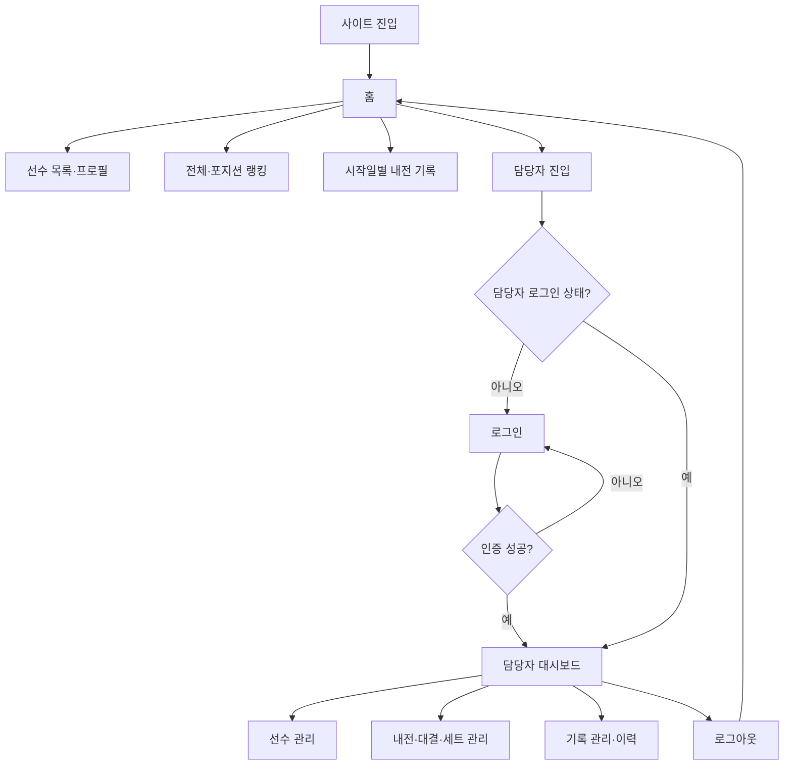
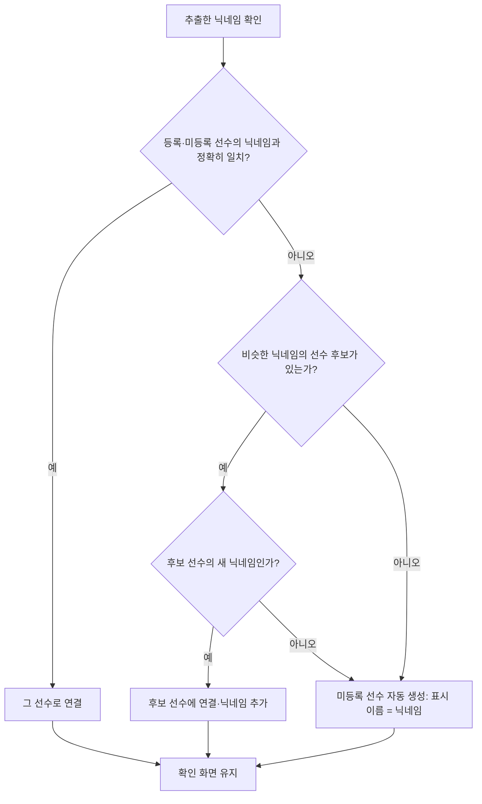
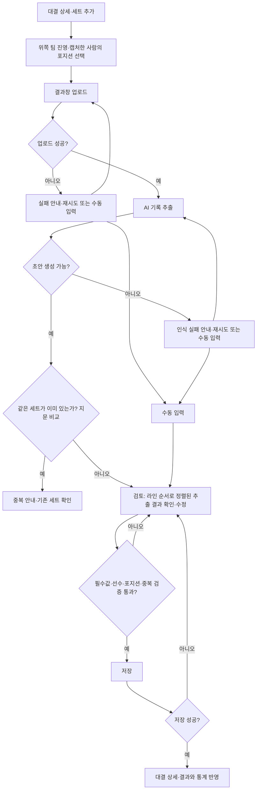

# 롤 내전 전적 사이트 — 유저플로우

- 작성일: 2026-10-16
- 대상: Manyfast 프로젝트 `56c1862e-4c54-43c5-bc76-322bbf457f30`
- 검토 기준: Manyfast 「새 플로우 2 v2」와 본 대화의 최신 결정 사항
- 용도: 기존 유저플로우의 누락·오연결을 보완하기 위한 화면 및 동작 정의
- 이 문서는 기획 산출물이며 Manyfast 캔버스는 수정하지 않았다.

## 1. 범위와 기본 원칙

### 사용자

| 사용자 | 허용 동작 |
|---|---|
| 일반 방문자 | 로그인 없이 선수 전적·랭킹·내전·밴 기록 조회 |
| 담당자 | ID·비밀번호로 로그인하여 선수·내전·경기 관리, 원본 이미지와 변경 이력 열람 |

담당자 계정은 하나이며 일반 유저 계정과 디스코드 로그인은 현재 구현 범위에서 제외한다. 공용 담당자 계정만으로 실제 작업자 개인을 식별할 수는 없다. CSV 다운로드는 일반 방문자도 사용할 수 있다(2026-10-16 결정).

저장된 세트는 별도 공개 단계 없이 즉시 공개 조회·통계에 반영된다. 선수 비활성화와 백업·복원 화면은 범위에서 제외하며, 백업·복원은 운영 작업으로 처리한다(2026-10-16 결정).

### 기록 계층

```text
내전 묶음: 시작일 기준
 ├ 대결 1: 팀 점수와 피어리스 제한을 이어가는 단위
 │  ├ 1세트: 실제 경기
 │  ├ 2세트
 │  └ 추가 세트
 └ 대결 2: 피어리스와 점수를 초기화한 새 대결
    └ 세트들
```

- 자정 이후 경기도 내전을 시작한 날짜의 묶음에 저장한다.
- 경기 수는 고정하지 않고 `2/3경기`와 같은 진행률도 표시하지 않는다.
- 중단·재경기는 등록 대상에서 제외하며 별도의 통계 포함·제외 설정을 만들지 않는다.
- 패치와 정확한 경기 시작 시각은 수집하지 않는다. 결과창의 날짜와 경기 소요 시간은 기록한다.
- 매치 ID는 수집하지 않는다. 같은 세트의 중복 등록은 결과창에서 읽은 세트 지문(§5.1)으로 막는다. 일반 Match-V5 자동 조회에는 의존하지 않는다.

### 팀·포지션·승률

- 1팀·2팀은 대결 안에서 이어지는 팀 구분이며(내전에서 실제로 쓰는 이름), 블루·레드는 세트별 진영이다.
- 대결의 1세트는 1팀 블루·2팀 레드로 시작하고, 진영은 매 세트 번갈아 바뀐다. 1팀은 홀수 세트에 블루, 짝수 세트에 레드다. 진영마다 밴 전략이 달라서다(2026-10-16 사용자 확인). 초기화로 만든 새 대결도 1세트는 1팀 블루다.
- 결과창의 `1번 팀`은 화면 위쪽 팀(캡처한 사람의 팀)을 뜻하며 내전의 1팀과 다르다. 혼동을 피하려고 문서와 화면에서는 결과창 기준으로 `위쪽 팀`·`아래쪽 팀`이라고 부른다.
- 같은 라인 선수 교환은 기존 대결의 점수와 피어리스 제한을 유지한다.
- 개인 기록은 각 세트에서 본인이 속했던 팀의 실제 승패를 따른다.
- 프로필 주력 포지션과 세트별 실제 포지션은 별개다. 실제 포지션은 경기 시작 시 정한 역할이다.
- 개인 승률은 `이긴 세트 수 ÷ 참여한 전체 세트 수`로 계산한다.
- 대결별 개인 결과는 해당 대결의 개인 세트 성적을 비교하여 승·무·패로 표시한다. 1승 1패는 대결 무승부이며 개인 승률은 50%이다.

## 2. 전체 진입 구조



관리 화면에 직접 접근한 경우에도 담당자 인증을 검사한다. 일반 방문자는 관리 데이터를 변경하거나 원본 스크린샷을 열람할 수 없다.

## 3. 선수 등록·닉네임 연결

### 3.1 선수 생성

`담당자 대시보드 → 선수 목록 → 새 선수 등록 → 정보 입력 → 저장 → 선수 상세`

입력·관리 정보:

- 고유 선수 ID: 시스템이 기록 연결에 사용한다.
- 사이트 표시 이름: 담당자가 미리 등록한 선수는 실명, 등록하지 않은 선수는 게임 닉네임으로 표시한다. 미등록 선수를 나중에 등록하면 실명으로 전환되고 기존 기록은 그대로 이어진다(2026-10-16 결정).
- 롤 닉네임 목록: 본계정·부계정·이전 닉네임을 같은 선수에 연결한다.
- 주력 포지션: 탑·정글·미드·원딜·서포터 중 하나를 지정한다.

### 3.2 선수 수정

`선수 목록 → 선수 상세·수정 → 표시 이름·닉네임 목록·주력 포지션 수정 → 저장 → 선수 상세`

- 선수 정보가 바뀌어도 선수 ID와 기존 경기 연결은 유지한다.
- 주력 포지션 수정은 과거 경기의 실제 포지션을 변경하지 않는다.
- 미등록 선수를 등록(실명 입력)해도 선수 ID가 같으므로 전적이 분리되지 않는다.
- 기존 플로우의 선수 비활성화는 확정 기능이 아니므로 이번 플로우에서 제외한다.

### 3.3 경기 검토 중 선수 연결



- 처음 보는 닉네임은 오류가 아니다. 미등록 선수로 저장되고 사이트에는 게임 닉네임으로 표시된다. 나중에 선수 관리에서 실명으로 등록하면 표시 이름이 바뀐다.
- 잘린 닉네임(`2630005513053…`)은 보이는 부분을 등록된 닉네임들의 앞부분과 비교해 약 70% 이상 일치하면 그 선수로 자동 연결한다. 내전 인원 안에서 닉네임이 겹칠 일이 없다는 전제다(2026-10-16 결정). 일치하는 선수가 없을 때만 담당자가 전체 닉네임을 입력해 미등록 선수로 저장한다.
- 비슷한 닉네임은 자동으로 연결하지 않고 후보를 보여준다(부계정·닉네임 변경·오인식 구분).
- 선수 연결을 바꿔도 다른 추출값은 유지된다.

## 4. 내전 묶음·대결 생성

### 4.1 내전 묶음

`담당자 대시보드 → 내전 목록 → 새 내전 묶음 → 시작일 지정 → 저장 → 내전 상세`

이미 만든 묶음은 내전 목록에서 선택한다. 다음 날 새벽에 업로드하더라도 선택한 시작일 묶음에 세트를 넣을 수 있어야 한다.

### 4.2 대결

`내전 상세 → 대결 생성 → 저장 → 대결 상세`

대결 상세에는 팀 세트 스코어, 세트 목록, 피어리스 제한 챔피언과 팀 교환·초기화 진입점을 표시한다. 세트마다 1팀의 진영을 기록하며 2팀은 반대 진영이다. 1팀·2팀 구성은 대결 생성 때 따로 입력하지 않고 첫 세트 등록 시 정해진다(§5.1).

## 5. 결과창 기반 세트 등록

### 5.1 정상 등록



결과창은 클립보드 붙여넣기(Ctrl+V)를 기본 입력으로 한다. 클라이언트에서 Win+Shift+S로 캡처한 뒤 파일 저장 없이 바로 붙여넣는 흐름이 목표이며, 파일 선택·끌어놓기는 보조 수단이다(2026-10-16 결정). 한 번에 세트 하나씩 올린다.

진영·캡처한 사람의 포지션은 업로드 전에 받는다. 검토 단계는 추출 결과에 틀린 곳이 있는지 확인·수정하는 용도로만 쓴다(2026-10-16 결정).

1팀·2팀은 담당자가 고르지 않는다(2026-10-16 결정).

- 위쪽 팀이 1팀인지 2팀인지는 선수 연결 후 직전 세트와 겹치는 선수가 많은 쪽으로 자동 판별해 확인 화면에 표시한다. 같은 라인 교환이 있어도 5명 중 다수는 그대로라 판별할 수 있다.
- 대결의 첫 세트에서는 블루 팀을 1팀으로 둔다(1세트 = 1팀 블루 규칙).
- 진영 선택의 기본값은 "캡처한 사람의 팀이 직전 세트와 같다"고 보고 규칙(1팀 홀수 세트 블루, 짝수 세트 레드)으로 미리 채운다. 첫 세트는 기본값이 없다. 선수 연결 후 판별한 1팀·2팀과 고른 진영이 규칙과 어긋나면 확인 화면에서 경고한다.
- "캡처한 사람의 팀이 직전 세트와 같다"는 가정은 같은 사람이 계속 캡처한다는 뜻이며 아직 검증하지 않았다. 가정이 틀려도 경고로 잡힌다.

매치 ID는 입력받지 않는다(2026-10-16 결정: 클라이언트에서 복사해야 해서 손이 많이 가고, 캡처한 사람과 등록하는 사람이 다르면 얻을 수 없음). 중복은 결과창에서 읽은 **세트 지문**으로 막는다.

- 지문: 결과창 날짜 + 경기 시간(분:초) + 양 팀 킬 합계 + 양 팀 골드 합계.
- 같은 이미지 재업로드는 이미지 해시로 추출 전에 먼저 막는다.
- 지문 검사는 추출 직후와 최종 저장 시 두 번 한다. 반복 제출이나 동시 저장이 있어도 같은 지문의 세트가 중복 저장되지 않아야 한다.
- 19명 규모에서 지문이 우연히 겹칠 가능성은 매우 낮다고 보지만 확률을 계산한 것은 아니다. 지문이 겹치면 예외 없이 등록할 수 없다(2026-10-16 결정).

### 5.2 추출·검토 정보

| 구분 | 항목 |
|---|---|
| 경기 | 결과창 날짜, 경기 소요 시간, 상단 승리·패배 |
| 선수 | 화면 행 위치, 닉네임, 챔피언, K/D/A, CS, 골드 |
| 밴 | 팀별 챔피언 5개와 아이콘 위치 |
| 담당자 지정 (업로드 전) | 내전·대결·세트 순서, 위쪽 팀 진영, 캡처한 사람의 실제 포지션 |
| 자동 판별 (확인 화면) | 위쪽 팀이 1팀인지 2팀인지 |

읽기 어려운 값은 확인 필요로 표시한다. AI가 만든 초안을 담당자가 수정할 수 있고, 숫자도 직접 수정할 수 있어야 한다. 진영·실제 포지션은 담당자가 필수 선택하며 추측만으로 확정하지 않는다.

검토 화면은 결과창의 화면 행 순서가 아니라 **팀별 탑·정글·미드·원딜·서포터 순서**로 정렬해서 보여준다. §5.3 규칙으로 배정한 포지션 기준이며, 원본과 대조할 수 있도록 각 행에 결과창 행 번호를 함께 표시한다. 포지션을 고치면 행이 그 라인 위치로 이동한다(같은 팀의 두 선수 포지션을 서로 맞바꾸는 방식). 진영·캡처한 사람의 포지션을 검토 중에 바꾸면 포지션·밴 순서를 다시 계산한다.

결과창 샘플 3장(2026-10-11~12)에서 확인한 사실:

- 게임 ID는 화면에 숫자로 표시되지 않고 복사 버튼만 있다. AI가 읽을 수 없어 매치 ID는 수집하지 않는다.
- 팀은 `1번 팀`·`2번 팀`으로만 표시되고 블루·레드는 표시되지 않는다. 진영을 담당자가 선택해야 하는 근거다.
- 헤더의 `18:14`, `25:42` 같은 값은 경기 소요 시간이다(시작 시각 아님). 날짜는 `2026/10/12`처럼 자정 이후 경기가 다음 날짜로 표시되므로 시작일 묶음 선택이 필요하다.
- 닉네임에는 태그(#KR1)가 표시되지 않는다. 긴 닉네임은 `2630005513053…`처럼 잘리고, 한글 외에 일본어·한자 닉네임도 있다.
- 챔피언 이름은 글자로 표시되지 않고 초상화 아이콘만 있다. 밴은 팀별로 위 3개·아래 2개의 작은 회색 아이콘에 사선이 그어져 있다.
- 팀 합계 K/D/A와 팀 골드가 팀 이름 옆에 표시되어 개인 기록 합계 검증에 쓸 수 있다.
- 목표물 수치와 아이템·룬도 표시되지만 수집 범위에서 제외한다.

### 5.3 승패·포지션 자동 배정

- 캡처한 사람은 위쪽 팀의 첫 번째 행에 있다.
- 상단 승리·패배는 위쪽 팀의 결과이며 아래쪽 팀은 반대 결과다.
- 위쪽 팀의 진영을 담당자가 선택하고 아래쪽 팀은 반대로 지정한다.
- 아래쪽 팀은 탑·정글·미드·원딜·서포터 순서로 배정한다.
- 위쪽 팀은 첫 번째 선수를 선택한 포지션으로 옮기고 나머지 순서를 유지한다.
- 예를 들어 첫 번째 선수가 원딜이면 화면 행은 원딜·탑·정글·미드·서포터로 해석한다.
- 자동 배정된 결과는 검토 화면에서 수정할 수 있다.
- 이 정렬 규칙은 샘플의 실제 포지션과 대조 검증해야 하는 전제다.
  - 샘플 3장 검증(2026-10-16, 사용자 확인): 캡처한 사람(전형적인ISTP)은 3장 모두 위쪽 팀 첫 행이다. 실제 포지션은 원딜·원딜·미드였고, 위쪽 팀 나머지 행과 아래쪽 팀은 모두 탑·정글·미드·원딜·서포터 순서(캡처한 사람의 포지션은 건너뜀)였다. 이 규칙과 일치한다.
  - 아직 확인하지 못한 것: 캡처한 사람이 탑·정글·서포터일 때의 배치.

### 5.4 밴 순서 배정

- 팀별 상단 왼쪽부터 1·2·3번, 하단 왼쪽부터 4·5번으로 읽는다.
- 전체 순서는 블루·레드가 번갈아 3개씩 밴한 뒤, 다시 블루·레드가 번갈아 2개씩 밴하는 규칙을 따른다.
  - 확정(2026-10-16, 사용자 확인): 2단계도 블루가 먼저 한다. 전체 순서는 B1 R1 B2 R2 B3 R3 → B4 R4 B5 R5.
- 진영 선택값과 위치를 조합해 전체 1~10번 순서를 구성한다.
- 담당자는 챔피언·밴 기록을 검토·수정할 수 있다.
- 내전 규칙상 매 세트 밴은 반드시 10개다. 밴 10개가 모두 채워지지 않으면 저장할 수 없다(2026-10-16 결정). 밴 생략 상태는 두지 않는다.
- 최종 픽 챔피언은 기록하지만 픽 순서는 수집하지 않는다.

### 5.5 저장 전 검증·실패 처리

- 선수 10명이며 동일 선수가 중복되지 않아야 한다.
- 밴 10개가 모두 있어야 한다.
- 각 팀에 실제 포지션 5개가 하나씩 배정되어야 한다.
- 진영·캡처한 사람의 포지션 등 필수 정보가 있어야 하고, 같은 지문의 세트가 없어야 한다.
- 팀 합계와 개인 기록 등 비교 가능한 값이 어긋나면 담당자에게 알린다.
- 피어리스 제한 챔피언이 발견되면 인식 오류 또는 초기화 누락 가능성을 알린다.
- 검증 실패 시 기존 입력을 유지하고 오류 위치를 수정할 수 있어야 한다.
- 저장 실패 시 성공한 것처럼 상세 화면으로 이동하지 않으며, 입력을 유지해 재시도한다.
- 합계 불일치·피어리스 위반·진영 불일치는 경고만 하고 저장을 막지 않는다(2026-10-16 결정). 재시도 횟수·파일 제한값은 미확정이다.
- 픽 챔피언 10개도 필수다(비어 있으면 저장 불가).

### 5.6 수동 입력

스크린샷 누락 시 등록 입력 화면에서 수동 입력으로 진입할 수 있다. 업로드·AI 실패 안내에서도 수동 입력으로 이어진다.

`수동 입력 → 선수 10명 선택·세트 기록 입력 → 진영·실제 포지션·팀 대응·밴 검토 → 공통 검증 → 저장`

AI 초안이 일부라도 있으면 읽힌 정보를 수정·보완하여 사용할 수 있다. 수동 경로도 날짜·경기 시간·킬·골드를 입력받아 같은 지문 검사와 동일한 저장 검증을 적용한다.

## 6. 팀 교환·피어리스 초기화

### 6.1 같은 라인 선수 교환

`대결 상세 → 팀 교환 → 교환할 양 팀 선수 선택 → 적용 → 대결 상세`

- 같은 라인 선수 교환을 기록한다.
- 기존 1팀·2팀의 점수와 피어리스 제한을 유지한다.
- 교환은 이후 세트 구성에 반영하고 이전 세트 소속·포지션·승패는 바꾸지 않는다.
- 각 선수의 개인 대결 성적은 본인이 실제로 뛴 세트 결과로 계산한다.
- 이미 등록된 세트의 오류를 고치는 동작은 팀 교환이 아니라 세트 수정 경로를 사용한다.

### 6.2 피어리스·점수 초기화

`대결 상세 → 피어리스·점수 초기화 → 새 대결 생성 → 팀 구성 확인·저장 → 새 대결 상세`

- 기존 대결·세트·점수·개인 기록을 삭제하거나 덮어쓰지 않는다.
- 새 대결의 팀 점수는 0:0으로 시작한다.
- 새 대결의 피어리스 제한은 비어 있는 상태로 시작한다.
- 첫 번째 세트가 저장되면 해당 10개 챔피언을 다음 세트의 양 팀 제한에 반영한다.
- 초기화 없이 세 번째 세트까지 진행하면 앞선 두 세트의 20개 챔피언을 제한한다.

중간 생성 취소만으로 기존 대결이 초기화되는 일이 없도록, 초기화 적용과 새 대결 저장의 관계를 명세에서 명확히 해야 한다.

## 7. 저장된 기록 수정·삭제·복구

### 7.1 세트 수정

`대결 상세 또는 기록 관리 → 기존 세트 선택 → 세트 수정 → 검증 → 저장 → 상세·통계 갱신`

선수 연결, 진영, 실제 포지션, 승패, 챔피언, K/D/A·CS·골드, 밴 기록 등을 수정한다. 날짜·경기 시간·킬·골드를 수정하면 지문 중복을 다시 검사한다.

수정 후 개인 전적·챔피언 통계·포지션 랭킹·팀 스코어·피어리스 제한·대결 결과·CSV가 현재 기록에 맞게 반영되어야 한다. 과거 세트의 챔피언 수정으로 뒤 세트의 피어리스 위반이 생기면 담당자가 확인할 수 있어야 한다.

### 7.2 세트 삭제·복구

`기록 관리 또는 세트 상세 → 삭제 → 유효 기록·집계에서 제외`

`기록 관리 → 삭제된 세트 목록 → 복구 → 유효 기록·집계에 재반영`

삭제는 복구 가능한 방식이다. 삭제·복구 시 팀 점수와 피어리스 제한도 관련 세트 기록을 기준으로 갱신한다. 같은 지문의 세트가 다른 유효 기록에 이미 존재하는 복구 충돌의 처리 방식은 미확정이다.

### 7.3 변경 이력·원본 확인

`기록 관리 → 세트 선택 → 변경 이력 조회`

`기록 관리 또는 세트 상세 → 원본 이미지 열람 → 검토·수정 화면으로 복귀`

이력에는 수정·삭제·복구 내용을 남긴다. 원본은 담당자만 열람한다. 세부 이력 필드·보존 기간·일반 방문자에 대한 이력 공개 여부는 별도 명세가 필요하다.

## 8. 일반 방문자 조회

### 8.1 내전 묶음부터 경기 상세까지

`홈 → 시작일별 내전 목록 → 내전 묶음 상세 → 대결 상세 → 세트 상세`

- 내전 묶음에서는 해당 시작일의 대결을 함께 표시한다.
- 대결 상세에는 팀 스코어, 세트 목록, 대결별 개인 승·무·패를 표시한다.
- 세트 상세에는 선수·팀·진영·실제 포지션·챔피언·K/D/A·CS·골드·승패·밴 순서를 표시한다.
- 피어리스 제한은 드래프트 밴 목록과 구분해서 표시한다.
- 날짜 범위는 내전 시작일을 기준으로 적용한다.

### 8.2 선수·챔피언 조회

`홈의 선수 목록 또는 랭킹 → 선수 선택 → 선수 프로필`

프로필에서 다음 정보를 표시한다.

- 표시 이름과 주력 포지션
- 참여 세트 수·세트 승패·개인 승률·누적 KDA·경기 참여율
- 대결별 개인 승·무·패
- 최근 경기
- 사용 챔피언과 챔피언별 사용 횟수·승패·승률·KDA

챔피언은 사용 횟수순으로 보여주고 표본 수를 함께 표시한다.

`최근 경기 선택 → 세트 상세`

`챔피언 선택 → 해당 선수의 해당 챔피언 경기 목록 → 세트 상세`

누적 KDA는 `총 (킬 + 어시스트) ÷ 총 데스`이며 데스가 0이면 PERFECT로 표시한다. 경기 참여율은 선택 기간의 참여 세트 수를 같은 기간의 등록된 전체 유효 세트 수로 나눈다.

### 8.3 랭킹

`홈 → 랭킹 → 전체 또는 포지션 탭 선택 → 기간·정렬 선택 → 선수 선택 → 프로필`

탭은 전체·탑·정글·미드·원딜·서포터다.

- 전체 탭은 모든 실제 참여 세트를 사용한다.
- 포지션 탭은 해당 포지션으로 실제 플레이한 세트만 사용한다.
- 순위·이름·경기 수·승패·개인 승률·KDA를 표시한다.
- 기본 정렬은 개인 승률이며 대결의 승리 비율로 바꾸지 않는다.
- 기본 동률 비교는 승률·참여 세트 수·KDA 순이며 모두 같으면 공동 순위다.
- 승률·KDA·참여 경기 수 정렬을 선택할 수 있다.
- 최소 표본 미달 선수도 기록은 표시하고 순위는 부여하지 않는다.
- 최소 표본은 **5세트**다(2026-10-16 결정). 5세트 미만인 선수는 기록은 보이고 순위만 없다.
- PERFECT(데스 0)는 KDA 정렬에서 **데스를 1로 보고 (킬+어시스트)를 값으로 비교**한다. 화면 표시는 PERFECT 그대로다(2026-10-16 결정).

### 8.4 검색·필터와 빈 결과

경기·밴 기록에서 시작일 범위, 선수, 챔피언 조건을 사용한다. 기본 기간은 전체 기간이다. 패치 필터는 제공하지 않는다.

`조건 지정 → 결과 목록 갱신 → 항목 선택 → 상세`

결과가 없으면 빈 결과와 조건 변경 경로를 제공한다. 일반 방문자가 원본 이미지를 열람하는 경로는 제공하지 않는다.

## 9. CSV 내보내기

`기록 조회 → CSV 내보내기 → 파일 다운로드`

- 경기·선수별 성적·실제 포지션·진영·밴 순서를 제공한다.
- 각 세트의 내전 묶음과 대결을 식별할 수 있어야 한다.
- 수정·삭제·복구가 반영된 유효 기록을 사용한다.
- 사용자에게 자동 밴 분석 결과를 제공하는 기능은 포함하지 않는다.
- 일반 방문자도 다운로드할 수 있다. 진입점은 기록 조회를 방해하지 않도록 목록 상단 구석의 작은 버튼으로만 둔다.
- 조회 필터 적용 범위, 파일 분리 방식·열 순서·인코딩은 아직 미확정이다.

## 10. 기존 Manyfast 플로우의 수정 목록

| 기존 위치 | 보완 내용 |
|---|---|
| 새 선수인가? → 임시 닉네임 유지 | 처음 보는 닉네임은 미등록 선수로 자동 생성해 닉네임으로 표시하고, 나중에 등록 시 실명으로 전환한다. |
| AI 인식 이후 매치 ID 중복 검사 | 매치 ID를 없애고, 이미지 해시(추출 전)와 세트 지문(추출 후·저장 시)으로 중복을 막는다. |
| 업로드·AI 실패 → 입력 화면 복귀 | 재시도와 수동 입력 경로를 함께 제공한다. |
| 포지션·진영·승패 수정 | 진영·캡처한 사람의 실제 포지션을 업로드 전에 필수 지정하고, 검토는 라인 순서로 정렬해 확인만 한다. |
| 팀 교환 적용 → 자기 화면 | 교환할 선수 선택과 기존 점수·제한·과거 기록 유지 규칙을 추가한다. |
| 피어리스 초기화 → 대결 생성 | 이전 기록 보존, 새 대결 0:0과 제한 초기화를 명시한다. |
| 세트 등록·검토 | 1팀·2팀은 선수 겹침으로 자동 판별하고, 세트별 블루·레드는 번갈아 규칙으로 기본값을 채운다. |
| 운영 관리 → 원본 열람 | 세트 수정·삭제·복구·변경 이력 경로를 추가한다. |
| 공개 대결 목록 | 시작일 묶음 → 대결 → 세트 상세의 공개 탐색 경로를 추가한다. |
| 선수 프로필 | 주력 포지션 수정과 최근 경기·챔피언별 경기에서 상세로 이동하는 경로를 추가한다. |
| 전적·랭킹 | 세트 기준 개인 승률과 대결 승·무·패를 명확히 구분한다. |
| 검색·분석 | 날짜·선수·챔피언 필터, 정렬, CSV 내보내기를 추가한다. |
| 선수 비활성화 | 현재 확정 범위에서 제외한다. |

## 11. 미확정 사항

다음 내용은 구현자가 임의로 결정하지 않도록 별도 확인 항목으로 남긴다.

1. (결정됨) 랭킹 최소 5세트, PERFECT는 데스 1로 계산해 정렬.
2. (결정됨) 합계 불일치·피어리스 위반·진영 불일치는 경고만 하고 저장은 허용. 밴 10개 필수·지문 중복 등록 불가·픽 챔피언 필수는 저장 차단.
3. AI 모델·정확도 목표·파일 제한·타임아웃 및 재시도 정책. 사용자는 무료 GPT를 희망하나, OpenAI API는 무료 등급이 없는 것으로 알고 있어 확인이 필요하다(구현 계획 단계에서 결정). AI가 읽을 것은 닉네임·숫자·날짜·시간·승패이고 챔피언은 아이콘 비교로 처리한다.
4. 원본 이미지·변경 이력의 보관 기간과 세부 이력 필드.
5. CSV 필터 적용 범위·파일 형식의 세부. (다운로드 권한은 방문자 허용으로 결정)
6. 삭제 기록 복구 시 지문 충돌 처리. (새 등록에서 지문이 겹치면 등록 불가로 결정됨)
7. (결정됨) 진영이 번갈아 규칙과 다르면 경고만 한다. 닉네임 매칭은 영문 대소문자를 구분하지 않는다(2026-10-16).
8. 대결 종료를 명시적으로 확정하는 동작이 필요한지와 미완료 대결의 결과 표시 방식.
9. 결과창 행 순서의 포지션 검증. 캡처한 사람이 원딜·미드인 샘플 3장으로 §5.3 규칙을 확인했다. 캡처한 사람이 탑·정글·서포터인 경우는 미확인이다.
10. 신규 챔피언 아이콘 갱신 방법. (챔피언 식별은 결과창 초상화·밴 아이콘을 잘라 Data Dragon 공식 아이콘과 비교해 챔피언 키로 바꾸는 방식으로 결정, 2026-10-16)

## 12. 흐름 검증 시나리오

1. 비로그인 방문자가 랭킹에서 선수를 선택하고 최근 경기 상세까지 조회한다.
2. 비로그인 방문자가 관리 화면이나 원본 이미지에 접근해도 관리·열람 권한을 얻지 못한다.
3. 10월 15일 시작한 내전에 10월 16일 새벽 결과창을 저장해도 같은 묶음에 남는다.
4. 4번째 이후 세트도 추가할 수 있고 3판 기준 진행률이 표시되지 않는다.
5. 이미 등록한 결과창을 다시 올리면 중복으로 안내되며 재시도·동시 저장으로도 중복 기록이 생기지 않는다.
6. AI 인식 실패 후 수동 입력으로 전환해 세트를 등록한다.
7. 처음 보는 닉네임은 미등록 선수로 저장되어 닉네임으로 표시되고, 나중에 실명으로 등록하면 과거 기록의 표시 이름도 실명으로 바뀐다.
8. 업로드 전에 캡처한 사람의 포지션을 원딜로 선택하면 위쪽 행이 원딜·탑·정글·미드·서포터로 배정되고, 검토 화면에서는 양 팀 모두 탑→서포터 순서로 정렬되어 보인다.
9. 진영 또는 포지션이 없거나 선수·포지션이 중복되면 저장되지 않는다.
10. 진영이 번갈아 바뀌는 세트에서도 1팀·2팀이 선수 겹침으로 올바르게 판별되고 기존 점수가 이어진다.
11. 같은 라인 교환 이후에도 이전 개인 기록·팀 점수·피어리스 제한이 유지된다.
12. 초기화 시 이전 기록은 남고 새 대결이 0:0·제한 없음으로 시작한다.
13. 초기화 없이 3세트를 등록하면 이전 20개 픽이 제한 목록에 나타난다.
14. 개인 1승 1패는 대결 무승부·개인 승률 50%로 표시된다.
15. 미드 6세트·원딜 3세트·서포터 1세트는 전체 10세트와 각 포지션 기록으로 나뉘며 주력 포지션 변경으로 과거 집계가 바뀌지 않는다.
16. 세트를 수정·삭제·복구하면 관련 팀 점수·통계·랭킹·제한 목록·CSV가 갱신된다.
17. 저장에 실패하면 입력이 유지되며 성공한 것처럼 공개되지 않는다.

## 13. 참고 자료

- 프로젝트: https://manyfast.io/editor/56c1862e-4c54-43c5-bc76-322bbf457f30?map=userFlowMap
- 검토한 버전: 새 플로우 2 v2 (`12335df5-863a-4c30-9a30-d0679c11e2ae`)
- 초기 방향 자료: 사용자가 공유한 `lol-inhouse/docs/handoff.md`이며, 이 문서와 충돌하면 대화의 최신 결정이 우선한다.
- 사용자가 제공한 롤 클라이언트 결과창 샘플들과 매치 조회 실험 결과를 반영했다.
- 참고 서비스: OP.GG, FOW, DEEPLOL, 내전.LOL이며 기능·조회 구성의 참고 용도다.

